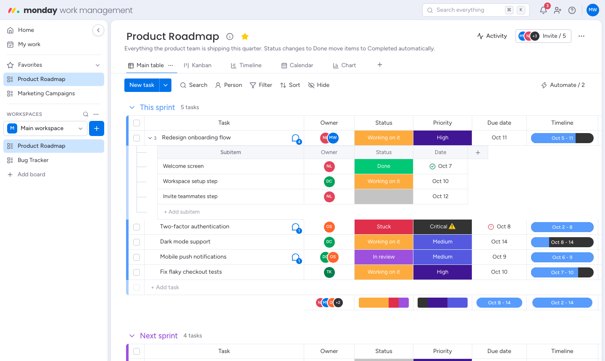
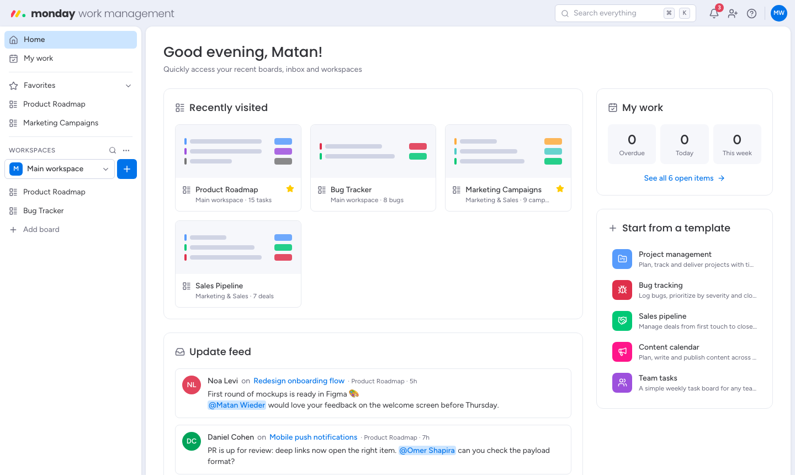
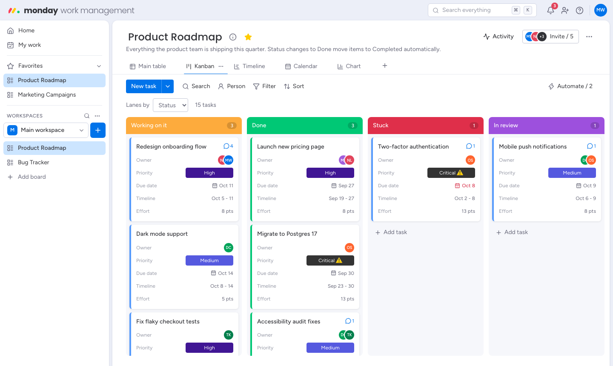
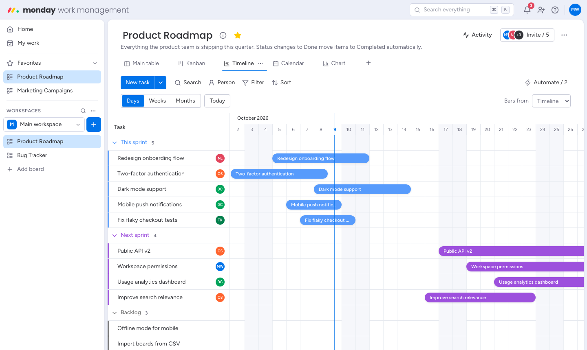
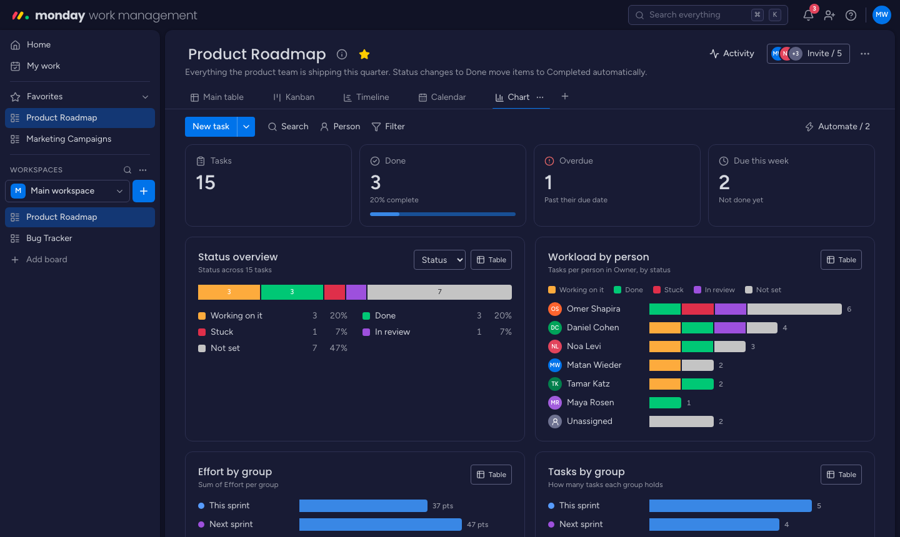

# monday — work management

A monday.com-style work management app: boards made of colored groups, typed
columns, inline editing, automations, and five ways to look at the same work.
It runs entirely in the browser — your workspace is saved to `localStorage`, so
there is no backend, account or database to set up.



## Features

**Boards & tables**
- Workspaces with boards, favorites, recently visited, and board templates
  (project management, bug tracking, sales pipeline, content calendar, team tasks, event planning)
- Colored, collapsible groups with per-group summaries (status battery, sums/averages, date ranges)
- 11 column types — Status, People, Date, Timeline, Numbers, Text, Tags, Checkbox, Rating,
  Link, Last updated — plus a Priority preset; labels and tags are editable in place
- Subitems with their own columns, nested under the parent item
- Inline editing everywhere, drag & drop for rows (across groups) and columns,
  resizable columns, multi-select with bulk duplicate / export / archive / delete / move
- Search, quick filters, a person filter, multi-column sort and hidden columns — saved per view

**Views** — Main table, Kanban (drag cards between status lanes), Calendar (drag to
reschedule), Timeline/Gantt (drag or stretch bars; day/week/month zoom) and a Chart
dashboard (status breakdown, workload per person, totals per group; each chart has a table view).

**Collaboration** — an item card with updates (@mentions, likes, replies, pinning,
editing), an info tab and a per-item activity log; a board activity log; notifications;
a "My work" page that collects everything assigned to you across boards.

**Automations** — "When Status changes to Done, move the item to Completed" and friends:
triggers (status changes, item created, person assigned) × actions (move to group, set
status, assign, set date to today, notify, archive). Ready-made suggestions per board.

**Everything else** — ⌘K command palette, undo (⌘Z and toast buttons), archive with
restore, CSV export, JSON backup & restore, light / dark / night themes, cross-tab sync.

| | |
|---|---|
|  |  |
|  |  |

## Getting started

```bash
npm install
npm run dev
```

Open <http://localhost:3000>. The app starts with a sample workspace; reset it anytime
from the profile menu → **Backup & restore**.

| Command | What it does |
|---|---|
| `npm run dev` | Development server |
| `npm run build` / `npm start` | Production build / server |
| `npm run lint` | ESLint (Next.js + React Compiler rules) |
| `npm test` | Unit tests for the data model (Vitest) |
| `npm run test:e2e` | End-to-end tests against a production build (Playwright; run `npx playwright install chromium` once) |

## Keyboard shortcuts

| Keys | Action |
|---|---|
| ⌘/Ctrl K | Search boards, items and actions |
| ⌘/Ctrl Z | Undo the last change |
| Enter | Save an edit, or add another item from "+ Add item" |
| Esc | Cancel editing, close panels, clear the selection |
| ? | Show shortcuts |

## How it's built

- **Next.js 16** (App Router, Cache Components, Partial Prefetching), **React 19.3**,
  **Tailwind CSS 4**, TypeScript.
- **State:** a Zustand store with immer, persisted to `localStorage` with batched
  writes. All writes go through pure functions in `src/lib/model.ts` (tested in
  `model.test.ts`); `src/lib/actions.ts` wraps them as undoable steps.
- **Rendering:** the root layout is a static frame (top bar, sidebar, main panel).
  Everything that reads workspace data renders in the browser only, via React 19.3's
  `use(browser())` inside `<Suspense>` boundaries with skeleton fallbacks — so the
  prerendered shell never mismatches what's in `localStorage`.
- **UI:** Radix primitives for menus, popovers, dialogs and tooltips; dnd-kit for
  drag & drop; lucide icons; date-fns.

```
src/
  app/            routes: /, /my-work, /boards/[boardId](/views/[viewId])
  components/
    app/          shell: top bar, sidebar, command palette, dialogs, toasts
    board/        board header, view tabs, toolbar, automations, activity, bulk actions
    table/        main table: groups, rows, headers, subitems, summaries
    cells/        one editor per column type
    views/        Kanban, Calendar, Timeline (Gantt), Chart
    item/         item card: updates, info, subitems, activity
    home/ mywork/ ui/
  lib/            types, model (state transitions), store, actions, filters,
                  automations, columns, seed data, templates, CSV
e2e/              Playwright tests
```

## Data

Your workspace lives in this browser's `localStorage` (key `monday-clone`). Use
**Backup & restore** in the profile menu to export it as JSON, move it to another
browser, or reset to the sample data. Clearing site data deletes it.

## Deploy

It's a standard Next.js app with no environment variables — deploy to Vercel (or any
Node host) as-is. Each visitor gets their own workspace in their own browser.
